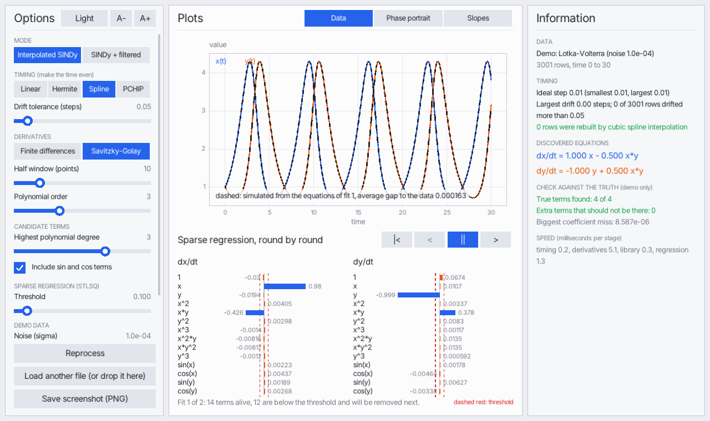
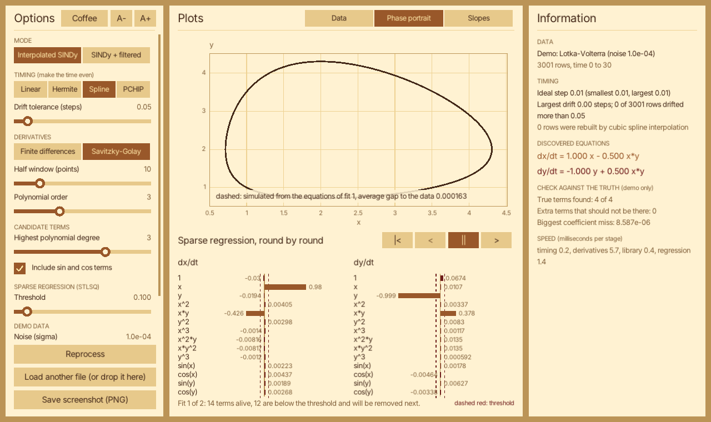

# EPnC: Explorers, Pioneers, not Caretakers

**Discover differential equations from noisy 2D data. Written from scratch in C.**

Give EPnC a table of `t, x, y` (a measured path, or a simulated one) and it tries to write down the law behind it, for example

```
dx/dt =  1.000 x - 0.500 x*y
dy/dt = -1.000 y + 0.500 x*y        (Lotka-Volterra, predator and prey)
```

It is a small, readable, header-only C library plus a GUI app that shows every step while it happens. It was built for a physics audience, with the goal that you can read and understand every line.

| Light theme, data tab | Coffee theme, phase portrait |
|---|---|
|  |  |

## How it works

1. **Even out the clock.** Real sensors do not sample at perfectly regular times. Rows whose time drifted are rebuilt by interpolation (linear, Hermite, cubic spline or PCHIP).
2. **Estimate the slopes** `dx/dt` and `dy/dt` from the noisy points: finite differences, Savitzky-Golay, or an experimental small neural network that is fitted to the data like a curve and differentiated exactly.
3. **Build a library of candidate terms:** `1, x, y, x², xy, y², x³, ..., sin x, cos y, ...`
4. **Sparse regression (STLSQ):** fit all terms by least squares, throw out the tiny coefficients, refit, repeat. What survives is the equation.
5. **Check it.** Simulate the discovered equation with RK4 and draw it over the data.

This is the SINDy idea of Brunton, Proctor and Kutz (2016), rebuilt from scratch in C, with the extra clock-repair and neural-curve steps. See `THIRD_PARTY.md` for the full credit.

## Build

You need **CMake 3.10+** and a C17 compiler. Nothing else for the library and tests. For the app, CMake downloads [raylib](https://www.raylib.com) 5.5 once (needs `git` and internet), unless raylib is already installed.

```
cmake -S . -B build
cmake --build build
```

- The result is `EPnC_App` plus one program per test (`test_01_...` and so on), in `build/` (or `build/Release/` with Visual Studio).
- **No GUI or no raylib?** Build only the library tests: `cmake -S . -B build -DWITH_GUI=OFF`.
- A Release build is the default for Makefiles and Ninja. The neural mode is about 10 times slower without optimization. In Visual Studio, pick the Release configuration yourself.
- On Linux, raylib needs the usual X11/OpenGL development packages (for example `libgl1-mesa-dev libx11-dev libxrandr-dev libxinerama-dev libxcursor-dev libxi-dev`).

## Use the app

```
EPnC_App                          (opens with a popup: drop a .csv, or pick a demo)
EPnC_App examples/JitteryLotkaVolterra.csv
EPnC_App --demo=1 --thresh=0.1
EPnC_App -h                       (all switches)
```

**Data format:** a text file with three columns `t, x, y`. Comma, semicolon, tab or space separated. A header line, blank lines and `#` comments are skipped. Time must be increasing.

The window has three panels: **Options** (left), **Plots** (middle), **Information** (right). Move the threshold slider and watch terms vanish. Use the play buttons to replay the STLSQ rounds. The dashed curves in the upper plots are the discovered equations simulated forward, with the average gap to your data.

### Included example files

- `examples/JitteryLotkaVolterra.csv`: 1501 rows, clock jitter up to 30% of a step, noise 1e-4. The defaults recover the exact equations.
- `examples/JitteryCircle.csv`: with the default library this one **fails**, on purpose. For values in [-1, 1] the columns `x`, `x³` and `sin x` are almost the same, so the method cannot tell them apart. Run `EPnC_App examples/JitteryCircle.csv --degree=1 --trig=0` and it finds `dx = y, dy = -x`. A good lesson that the library you choose matters.

## Use it as a library

Everything is header-only, with `#include <EPnC.h>` and `-I Core`. Only libc and libm are needed. The same five steps in code:

```c
#include <EPnC.h>

int main (void)
{
    Matrix Path = LoadPathFromCsv("examples/JitteryLotkaVolterra.csv");           //columns t, x, y

    bool* WasInterpolated = (bool*) calloc(Path.RowCount, sizeof(bool));
    Matrix Even = MakeTimeEven(&Path, INTERP_SPLINE, 0.05, WasInterpolated);      //1. even clock
    Matrix Slopes = SavitzkyGolayDerivatives(&Even, 10, 3);                       //2. dx/dt, dy/dt

    TermLibrary Library = CreateTermLibrary(3, true);                             //3. 1, x, y, x^2, x*y, ..., sin, cos
    Matrix Theta = BuildTermMatrix(&Library, &Even, 1, 2);

    double* Target = (double*) calloc(Even.RowCount, sizeof(double));
    double* Coefficients = (double*) calloc(Library.TermCount, sizeof(double));

    for (size_t ThisRow=0; ThisRow<Even.RowCount; ThisRow++) Target[ThisRow] = GetMatrixCell(&Slopes, ThisRow, 0);
    SparseRegressionSTLSQ(&Theta, Target, 0.1, 1e-10, 10, Coefficients);          //4. keep only a few terms
    PrintEquation("dx/dt", &Library, Coefficients, 0.0, 3);
    printf("\n");

    for (size_t ThisRow=0; ThisRow<Even.RowCount; ThisRow++) Target[ThisRow] = GetMatrixCell(&Slopes, ThisRow, 1);
    SparseRegressionSTLSQ(&Theta, Target, 0.1, 1e-10, 10, Coefficients);
    PrintEquation("dy/dt", &Library, Coefficients, 0.0, 3);
    printf("\n");
    return 0;
}
```

Output: `dx/dt = 1.000x - 0.500x*y` and `dy/dt = -1.000y + 0.500x*y`. (The example leaves out the cleanup calls for brevity. Every function is documented in its header.)

### Where things live

| File in `Core/` | What it does |
|---|---|
| `RandomNoiseGenerator.h` | xorshift random numbers, Gaussian noise (Box-Muller) |
| `LinearAlgebraSolver.h` | `Matrix`, Gauss elimination (Gauss-Seidel as an option), least squares with ridge |
| `OdeSolverAndSystems.h` | RK4 and five test systems (linear spiral, Lotka-Volterra, Van der Pol, damped pendulum, Duffing) |
| `CsvPathLoader.h` | load and save `t,x,y` files |
| `TimingInterpolate.h` | find uneven clocks and repair them |
| `DerivativeEstimation.h` | finite differences, Savitzky-Golay |
| `NeuralDerivativeNetwork.h` | experimental: tiny `tanh` network fitted to the data, exact slope, hand-written backprop and Adam |
| `CandidateTermLibrary.h` | the term library and the matrix `Theta` |
| `SparseRegressionSTLSQ.h` | STLSQ, also as a resumable `StlsqJob` for the animation |
| `GroundTruthCoefficients.h` | answer keys for the demo systems |
| `EPnC_Gui.h` | the raylib app (only with `-DWITH_GUI`) |
| `EPnC.h` | umbrella header for everything except the GUI |

The `tests/` programs are small, runnable lessons. Each has `-h` for a guide, and `test_09_GuidedTour` walks through the whole method in slow motion in the terminal.

## Limitations (please read)

EPnC is **not a universal equation finder**. It is honest about where it breaks:

- **It only finds what is in its library.** If the true law contains a term that is not a candidate, the result is wrong, and STLSQ will not tell you. The demos show this on purpose.
- **Data decides, not only the method.** A single closed orbit is one thin curve in the plane. With a big library its terms cannot be told apart. Several runs from different starting points fix this, but the app loads one path only.
- **Noise hurts a lot.** Slopes from noisy points are noisy. Finite differences already break near noise 1e-4 to 1e-3. Savitzky-Golay holds out longer.
- **The neural mode is experimental.** In tests with Lotka-Volterra it recovered the exact equations at noise 1e-2 where it beat Savitzky-Golay, but it has an error floor of about 0.02 to 0.03, so at low noise Savitzky-Golay is clearly better. The Duffing demo fails for both. It needs about 7 seconds for 3001 points. Do not take it as "neural networks beat classic filters".
- **The threshold is one absolute number** for all terms. Terms of very different size are treated unfairly.
- **Only 2D systems** (`x`, `y`), and the time column must be sorted.
- **No error handling by design.** The code is meant to be read; missing checks are noted in the `@warning` lines of each function. A bad file or an empty data set can crash it.
- **Platform notes:** developed on Windows, build checked on Linux (with a headless raylib). macOS is untested. Mouse input and drag-and-drop in the GUI have had little testing. Please report problems.

## Contributing

This started as a personal learning project, so the code follows a deliberately plain style: PascalCase names, Allman braces, no clever tricks, no pointer gymnastics, every function documented. Bug reports and small fixes are welcome. If you add a header, add a `tests/test_XX_*.c` with a `-h` guide, like the others.

## License

GNU General Public License v3.0 or later (`GPL-3.0-or-later`). See `LICENSE`. Raylib (zlib) and the embedded Inter font (SIL OFL 1.1) are covered in `THIRD_PARTY.md`.

Copyright (C) 2026 Bedanta Hazarika (@bedantahazarika)
